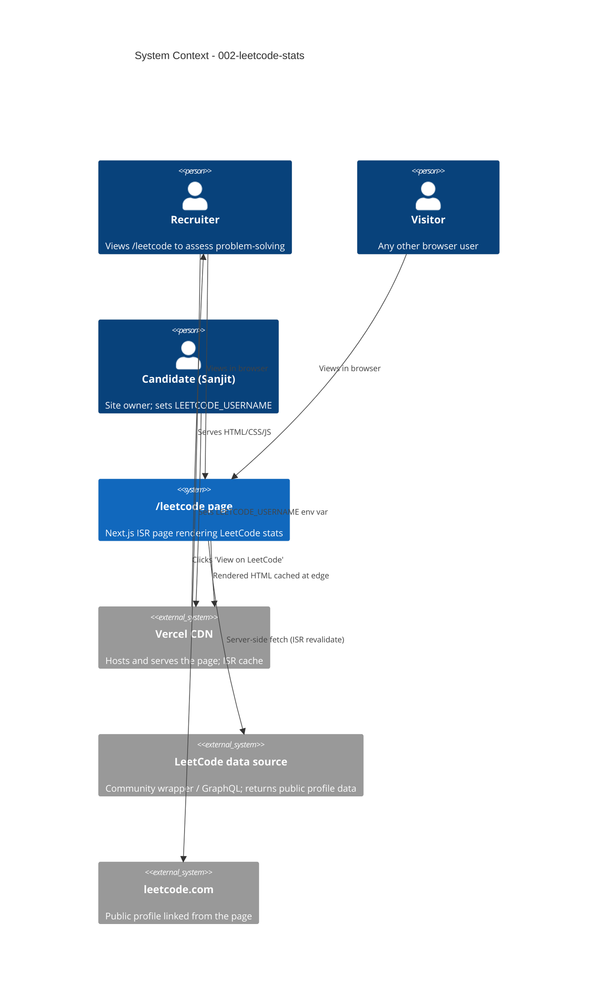

# 002-leetcode-stats - System Context

## System Overview

A new `/leetcode` route in the existing Next.js (App Router) portfolio that fetches the public LeetCode profile of user `sanjit12` server-side, caches the response with Incremental Static Regeneration (ISR, ~1 hour revalidate), and renders recruiter-friendly visualizations: headline KPI cards, a difficulty distribution chart, a topic-tag distribution chart, a contest rating timeline, and a 90-day activity heatmap. Data is fetched only at ISR revalidate time (and on first request) — never per visitor — to keep the LeetCode API strategy private and avoid rate limits.

The page reuses the existing site layout (header, footer, theme, dark/light parity) and is added to the main navigation plus a home-page callout card. A "View on LeetCode" CTA links to the public profile.

## Actors

| Actor | Type | Description |
|-------|------|-------------|
| **Recruiter / Hiring Manager** | Human | Primary audience. Visits `/leetcode` from the home page or nav to evaluate problem-solving capability. Wants scannable visuals. |
| **Visitor (general)** | Human | Anyone who finds the page. Same read-only behavior. |
| **Candidate (Sanjit)** | Human (owner) | Configures `LEETCODE_USERNAME` env var if it ever needs to change. Not a runtime user. |
| **LeetCode API (community wrapper / GraphQL)** | System | External data source. Read-only. Returns public profile + recent submission metadata. |
| **Vercel ISR** | System | Caches the rendered page; regenerates in the background after the revalidate window. |

## External Integrations

| System | Purpose | Direction | Data Exchanged | Protocol |
|--------|---------|-----------|----------------|----------|
| **LeetCode data source** (community wrapper such as `leetcode-query` / `alfa-leetcode-api` / `leetcode-stats`) | Source of profile + activity data | Outbound (server-side only) | JSON: profile, solved counts, contest history, recent submissions, topic tags | HTTPS / GraphQL or REST (wrapper-dependent) |
| **Vercel CDN** | Hosts and serves the page | Inbound (to visitor) | Static HTML/CSS/JS for `/leetcode` | HTTPS |

> The exact LeetCode data-source library is **TBD** in Construction. The interface contract is fixed: a function returning `LeetCodeProfile` (typed) that the page consumes.

## Data Flows

### Build / ISR (server-side, every ~1 hour)
1. Next.js renders `/leetcode` at request time if cache is stale.
2. A server-side fetcher calls the LeetCode data source with `LEETCODE_USERNAME` (default `sanjit12`).
3. Response is normalized into typed `LeetCodeProfile` and `LeetCodeActivity`.
4. Page is rendered with the data; HTML is cached at the edge and served to subsequent visitors until the next revalidate.

### Runtime (visitor)
- Browser loads the cached static HTML for `/leetcode`.
- No client-side fetch to LeetCode. Charts hydrate from the server-rendered payload.
- Stale-data banner (if applicable) and "View on LeetCode" CTA are pure HTML.

### Outbound
- Recruiter clicks "View on LeetCode" → opens `https://leetcode.com/sanjit12/` in a new tab.

### System Context Diagram

## High-Level Constraints

- **Server-side fetch only**: The browser must never call LeetCode directly. No API keys, no wrapper tokens, no `LEETCODE_USERNAME` in client bundles.
- **No paid tiers**: Use a free community wrapper or the public LeetCode GraphQL endpoint. Honor rate limits (ISR absorbs traffic).
- **ISR with ~1h revalidate**: Fresh enough to feel live, slow enough to never break from a transient LeetCode outage. Stale-data is preferred to a 5xx.
- **Theme parity**: All charts and the heatmap must render correctly in both light and dark modes.
- **No new runtime backend**: This intent uses Next.js Server Components + ISR. No API routes, no serverless functions, no database.
- **Reuse the existing design system**: Match typography, spacing, color tokens, and component patterns from `001-portfolio-site`.
- **Accessibility**: Charts must have `aria-label`s, text alternatives, and `prefers-reduced-motion` respected for animations.

## Key NFR Goals

- **Performance**: p95 LCP < 2.5s on cold cache; < 1.0s on warm cache. Lighthouse Performance ≥ 90.
- **Reliability**: Page must render successfully on every request — including when the LeetCode API is down — by falling back to last-known data with a stale banner.
- **Maintainability**: New code in `src/lib/leetcode/` and `src/app/leetcode/` follows the same patterns as `src/lib/cv-data.ts` and `src/app/`.
- **Privacy**: Only the public LeetCode username is referenced. No PII, no analytics on `/leetcode` beyond what the rest of the site already uses.

## Future-Proofing Notes (out of scope)

- A "refresh now" admin button is **not** in scope; revalidation is purely time-based.
- A timeline of rating history beyond 20 contests is **not** in scope.
- Tracking personal bests per topic is **not** in scope.
