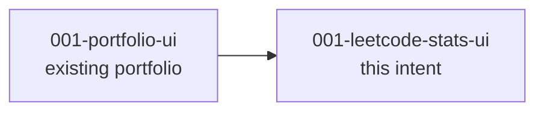

# 002-leetcode-stats - Unit Decomposition

## Units Overview

This intent decomposes into **1 unit** of work. The project is a single Next.js application; per the project type configuration (`frontend-app`), the catalog specifies a single frontend unit with `feature-based` decomposition and `simple-construction-bolt` as the default bolt type. The LeetCode feature is a new route + visualization layer inside that same app — it shares the layout, theme, design system, and deployment of `001-portfolio-site`. Splitting it into multiple units would create false boundaries.

The unit internally groups its stories by feature (data layer, KPI cards, charts, heatmap, etc.) — but these are **features, not separate units**, because they all render inside the same Next.js route, share the same server-side data fetch, and deploy as one bundle.

### Unit 1: 001-leetcode-stats-ui

**Description**: A new `/leetcode` route inside the existing Next.js portfolio. Server-side fetches and caches the `sanjit12` LeetCode profile via ISR (~1h revalidate), normalizes the data into typed structures, and renders recruiter-friendly visualizations: KPI cards, difficulty donut, topic distribution, contest rating timeline, and 90-day activity heatmap. Adds a nav entry and a home-page callout card.

**Stories** (8 total — see Unit Brief for full list):

- 001-leetcode-data: Data layer — types, server-side fetcher, env config, normalization, stale-data handling
- 002-leetcode-route-and-nav: `/leetcode` route + main nav entry
- 003-leetcode-home-callout: Home-page callout card linking to `/leetcode`
- 004-kpi-cards: Four headline KPI tiles (Total Solved, Acceptance Rate, Global Ranking, Contribution Points)
- 005-difficulty-chart: Difficulty distribution donut/bar
- 006-topic-chart: Topic/tag distribution bar chart
- 007-activity-heatmap: 90-day GitHub-style activity heatmap
- 008-contest-timeline: Contest rating sparkline + badge + "Top X%"

**Deliverables**:

- `src/lib/leetcode/types.ts` — TypeScript types for LeetCode profile + activity
- `src/lib/leetcode/fetcher.ts` — Server-side fetch with normalization and stale-state handling
- `src/lib/leetcode/fetcher.test.ts` — Unit tests for normalization and graceful failure
- `src/app/leetcode/page.tsx` — Server component rendering the page
- `src/app/leetcode/page.test.tsx` — Smoke test (renders without error)
- `src/app/leetcode/loading.tsx` — Loading state (skeleton)
- `src/components/leetcode/*` — Feature components: `KpiCards`, `DifficultyChart`, `TopicChart`, `ActivityHeatmap`, `ContestTimeline`, `StaleDataBanner`, `LeetCodeCta`
- `src/components/leetcode/__tests__/*` — Component tests where meaningful
- `src/components/home/leetcode-callout.tsx` — Home-page callout card
- Updated `src/components/nav/` — Add `/leetcode` entry
- `.env.example` — Document `LEETCODE_USERNAME`
- `docs/leetcode.md` — Brief developer doc (data source, env var, how to revalidate)

**Dependencies**:

- Depends on: `001-portfolio-ui` (the existing portfolio) — reuses layout, design system, theme
- Depended by: None

**External Dependencies**:

| System | Purpose | Risk |
|--------|---------|------|
| LeetCode data source (TBD: `leetcode-query` / `alfa-leetcode-api` / direct GraphQL) | Profile + activity data | Medium (community wrappers can break; mitigated by ISR + graceful stale state) |
| Vercel ISR | Caching + on-demand revalidation | Low (already in use) |
| Charts library (TBD: Recharts / Visx / custom SVG) | Visualizations | Low (one-time dependency decision) |

**Estimated Complexity**: **M** (Medium) — Several distinct visualizations, a non-trivial data-shape adaptation, and a graceful-failure contract, but no backend and no auth.

## Unit Dependency Graph

```text
[001-portfolio-ui]  ──►  [001-leetcode-stats-ui]
       (existing)             (this intent)
```



## Execution Order

Construction will execute as a single unit. Within the unit, stories are grouped into **3 construction bolts** by logical layer (foundation → visualizations → polish):

| Bolt | Bolt Type | Stories | Objective |
|------|-----------|---------|-----------|
| `004-leetcode-stats-ui-foundation` | Simple | 001, 002, 003 | Data layer, route, nav, home callout — proves the page renders with real data end-to-end |
| `005-leetcode-stats-ui-visualizations` | Simple | 004, 005, 006, 007 | KPI cards + difficulty chart + topic chart + activity heatmap — the core "wow" |
| `006-leetcode-stats-ui-polish` | Simple | 008, plus contest-related polish | Contest rating timeline, stale-data banner refinement, CTA polish, dev doc |

### Why 3 bolts (not 1 monolith, not 8 micro-bolts)

- **Foundation first** — the data layer, route, and nav entry must exist before any chart can render. Foundation proves the end-to-end pipeline (fetch → cache → render).
- **Visualizations together** — KPI cards + the three charts are the visual heart of the page. Building them in one bolt keeps the AI agent's context focused on the design system + charts library, and lets us iterate on visual style as a unit.
- **Polish last** — contest timeline is a Should-have refinement; plus dev docs and final visual polish. Doing this last means polish happens against a fully working page.

This sequencing keeps each bolt at "hours, not days" while preserving the ability to verify at the end of each bolt (the page is renderable after Bolt 1, the page is visually complete after Bolt 2, the page is production-ready after Bolt 3).

## Requirement-to-Unit Mapping

| FR | Requirement | → Unit |
|----|-------------|--------|
| FR-1 | Dedicated LeetCode page route (+ nav + home highlight) | `001-leetcode-stats-ui` |
| FR-2 | Fetch live LeetCode profile data | `001-leetcode-stats-ui` |
| FR-3 | Visual difficulty distribution chart | `001-leetcode-stats-ui` |
| FR-4 | Visual topic/tag distribution | `001-leetcode-stats-ui` |
| FR-5 | Headline KPI cards | `001-leetcode-stats-ui` |
| FR-6 | Recent activity / streak heatmap | `001-leetcode-stats-ui` |
| FR-7 | Contest rating / badge timeline | `001-leetcode-stats-ui` |
| FR-8 | Graceful error / stale state | `001-leetcode-stats-ui` |
| FR-9 | Link to live LeetCode profile | `001-leetcode-stats-ui` |

All 9 FRs map to the single unit (every FR is a feature of the same page).

## Decisions

| Decision | Rationale |
|----------|-----------|
| Single frontend unit (not split by feature into multiple units) | Mirrors the precedent set by `001-portfolio-ui`: features are stories, not units, when they share a route, data, and deployment. |
| 3 bolts within the unit, not 1 or 8 | Foundation → Visualizations → Polish is the proven sequencing for the existing portfolio. Same balance applies here. |
| `simple-construction-bolt` for every bolt | No backend, no auth, no complex business logic. Catalog default for `frontend-app`. |
| ISR with ~1h revalidate (not build-time, not per-request) | User-confirmed at Checkpoint 1. Balances freshness, scale, and rate-limit safety. |
| Server-side fetch only (no client-side LeetCode calls) | Privacy (no API strategy exposed), reliability (one fetch per hour vs. one per visitor), and consistent rendering. |
| Story-index marker update happens in Bolt 3 polish | The story-index convention from `001-portfolio-site` is updated when the feature ships, not in Bolt 1. |
